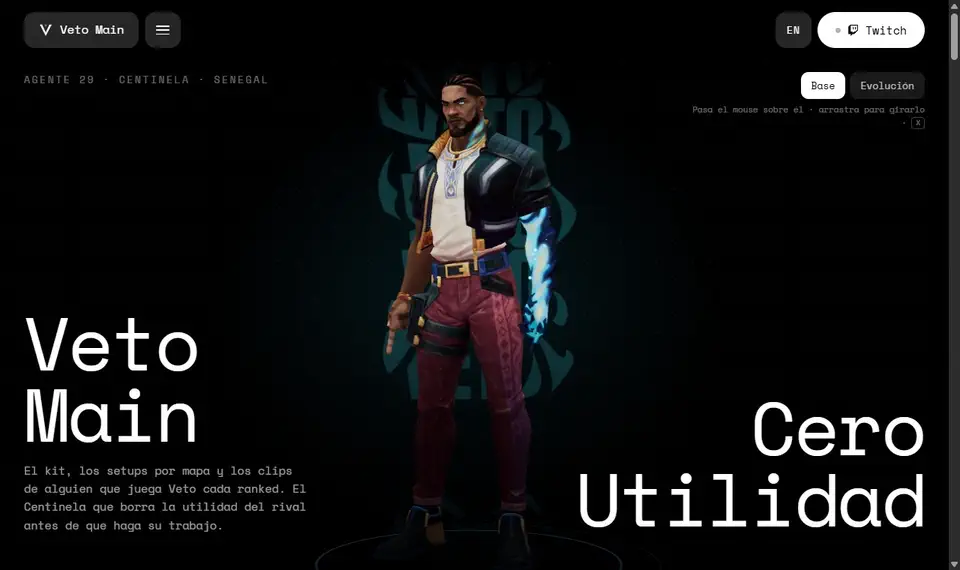
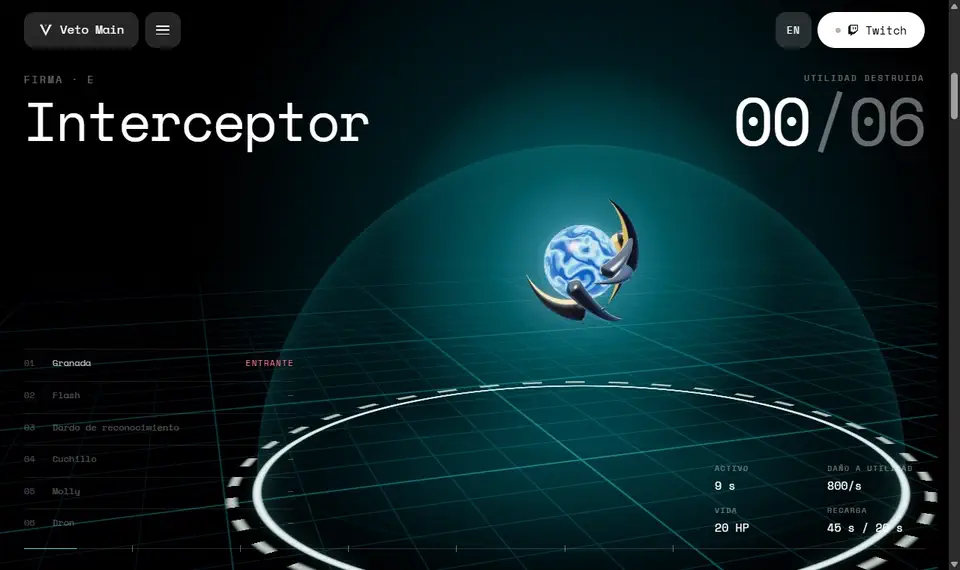
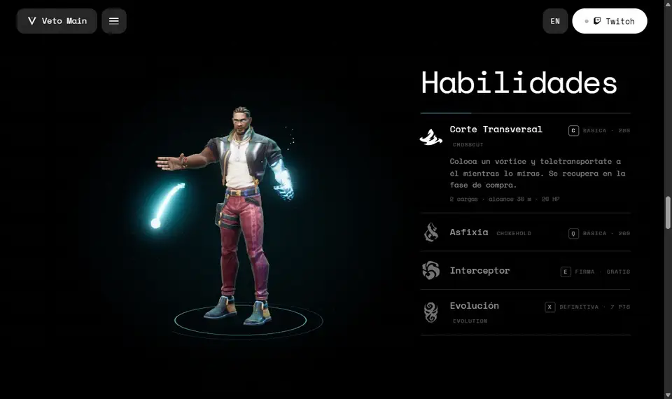
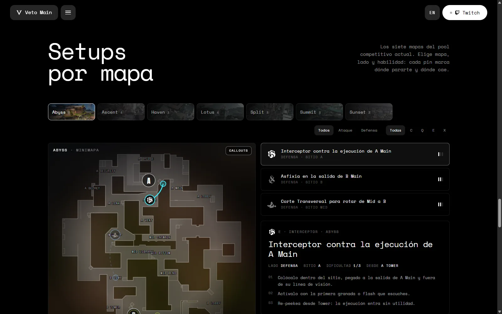
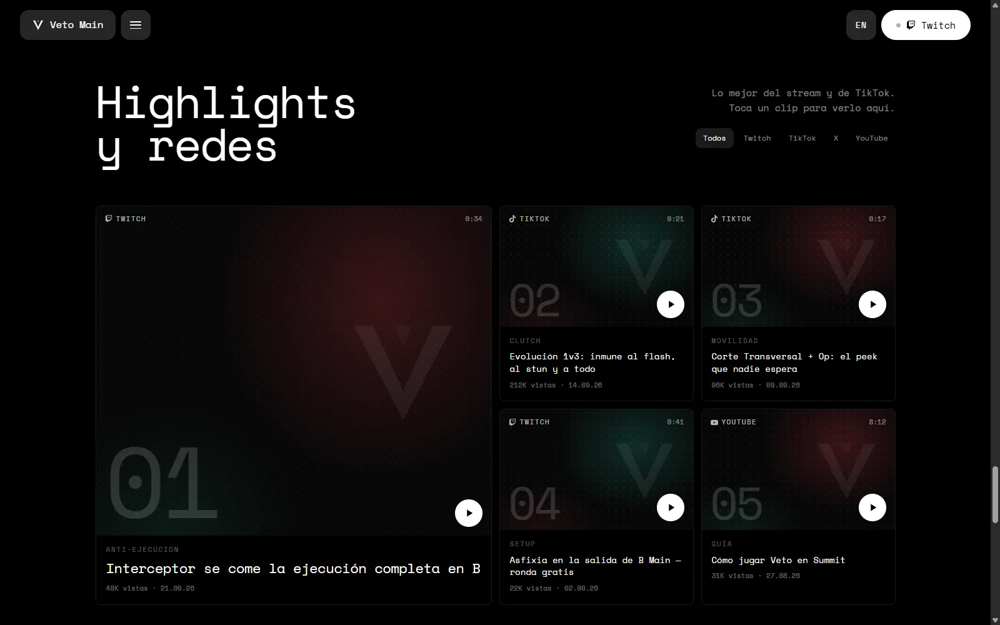
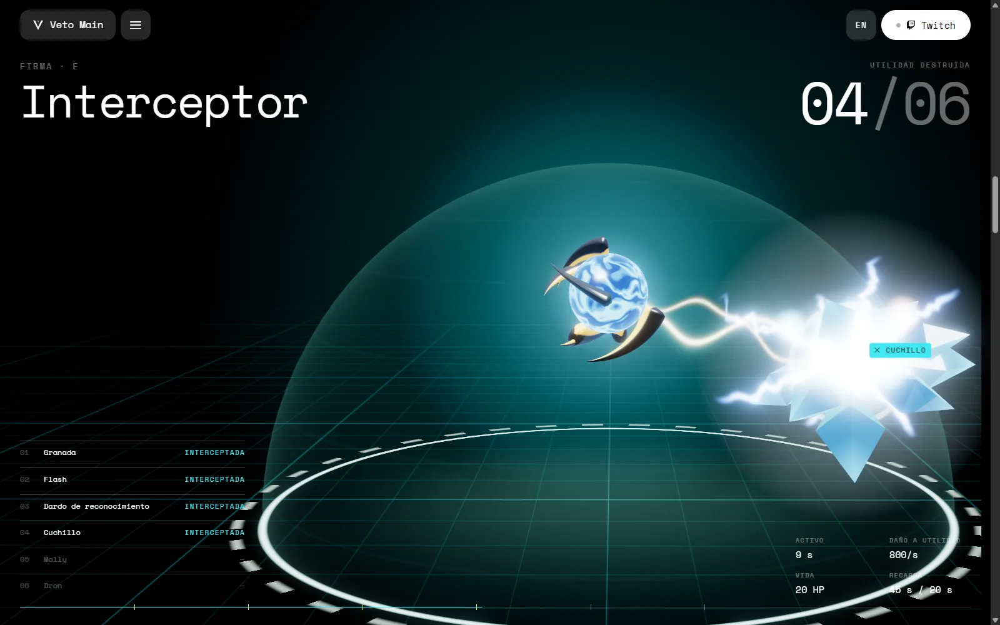
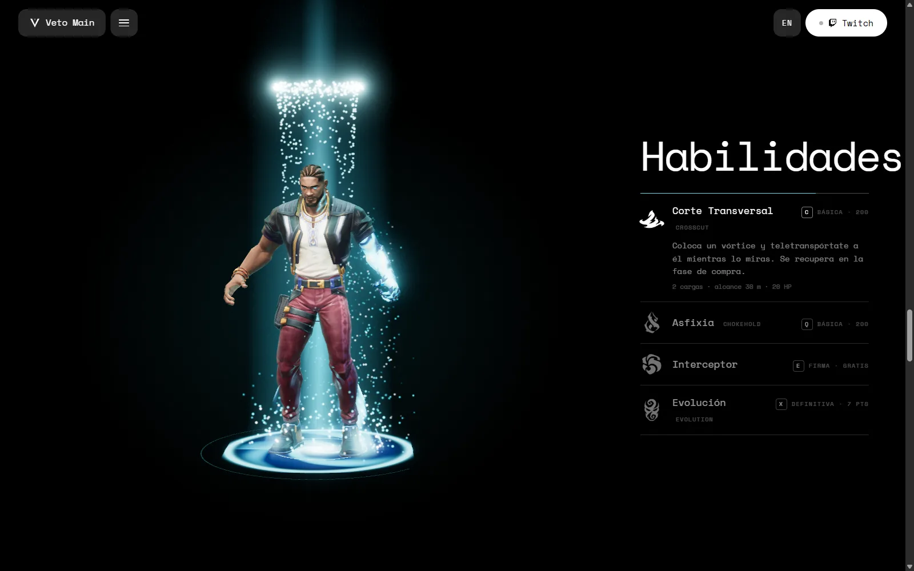

<h1>Veto Main</h1>

<b>Cero utilidad.</b> 
Un hub de fan para quien mainea a Veto en VALORANT, con el agente vivo en 3D.

  

 

> Lo hice para probar algo: meter un personaje 3D de verdad dentro de una página web y que se sienta vivo, no como un modelo de exhibición.

 

## ✦ Lo que hace

<table>
  <tr>
    <td width="50%" valign="top"><b>Te sigue con la mirada</b> Pasa el mouse sobre él y el reflector revela su forma Evolución. Arrástralo para girarlo.</td>
    <td width="50%" valign="top"><b>Usa sus habilidades</b> Corte Transversal, Asfixia, Interceptor y Evolución, cada una con sus efectos.</td>
  </tr>
  <tr>
    <td valign="top"><b>El Interceptor va con el scroll</b> Atrapa seis utilidades enemigas una por una. Si subes, el tiempo va hacia atrás.</td>
    <td valign="top"><b>Huesos con resortes</b> Cada parte del cuerpo tiene su inercia y su rebote: nada se mueve en bloque.</td>
  </tr>
  <tr>
    <td valign="top"><b>Setups por mapa</b> Los 7 mapas del pool competitivo con sus minimapas oficiales.</td>
    <td valign="top"><b>Clips y redes</b> Highlights de Twitch, YouTube y TikTok dentro del sitio.</td>
  </tr>
</table>

 

## ✦ El Interceptor

 

## ✦ El kit

 

## ✦ Pantallas

<table>
  <tr>
    <td width="50%">
Setups por mapa
</td>
    <td width="50%">
Highlights y redes
</td>
  </tr>
  <tr>
    <td>
Utilidad interceptada
</td>
    <td>
Corte Transversal
</td>
  </tr>
</table>

 

---

Diseñado y programado por <a href="https://carloramirez.dev"><b>Carlo Ramírez</b></a> · 2026
  
Modelos «Veto (T-pose)» y «Veto (Ult Form) (T-pose)» por <b>BojanV06</b> (Sketchfab), bajo licencia CC BY 4.0. Modelo y animación de selección de agente, modelos de utilidad, arte, íconos y minimapas: Riot Games (vía tracker.gg, Kingdom Archives y valorant-api.com).
 
Veto Main es un proyecto de fan creado bajo la política «Legal Jibber Jabber» de Riot Games, usando recursos propiedad de Riot Games. Riot Games no respalda ni patrocina este proyecto.

